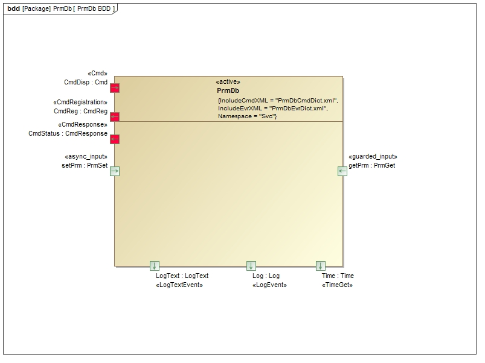
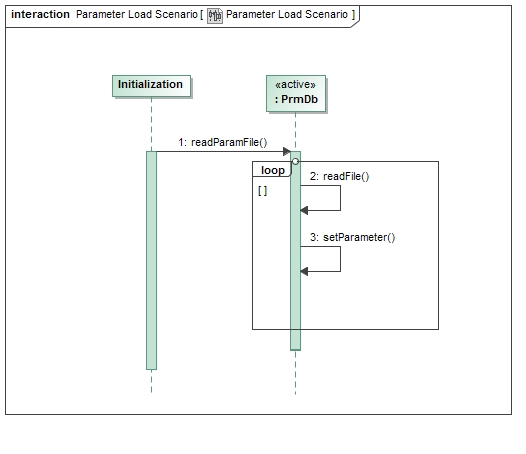
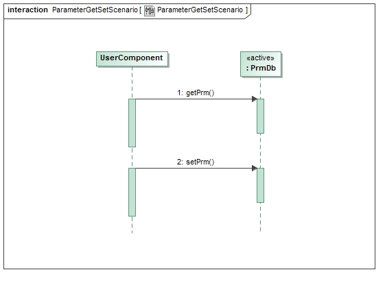
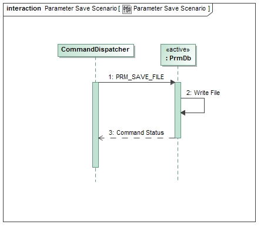

# Svc::PrmDb Component

## 1. Introduction

The `Svc::PrmDb` Component is used to store parameter values used by other components. The values are stored in serialized form. During initialization, `Svc::PrmDb` loads a set of parameters from a file, and stores the values in a table based on the parameter ID. Components that need parameters request their values during initialization after they have been loaded. Components occasionally receive updates to parameter values via a command, and the new values will be sent to `Svc::PrmDb`. A command will save the copy in memory back to the file.

## 2. Requirements

The requirements for `Svc::TlmChan` are as follows:

Requirement | Description | Verification Method
----------- | ----------- | -------------------
PRMDB-001 | The `Svc::PrmDb` component shall load parameter values from a file | Unit Test
PRMDB-002 | The `Svc::PrmDb` component shall provide an interface to read parameter values | Inspection, Unit Test
PRMDB-003 | The `Svc::PrmDb` component shall provide an interface to update parameter values | Inspection, Unit Test
PRMDB-004 | The `Svc::PrmDb` component shall provide a command to save the current parameter values | Inspection, Unit Test
PRMDB-005 | The `Svc::PrmDb` component shall reject a `PRM_LOAD_FILE` command with an empty file name with a `VALIDATION_ERROR` response and a `PrmDbFileLoadFailed` event, without asserting or altering the staging database | Unit Test, Integration Test
PRMDB-006 | The `Svc::PrmDb` component shall provide a command to request a data product snapshot of active-database parameter entries in an ID range | Unit Test

## 3. Design

### 3.1 Context

#### 3.1.1 Component Diagram

The `Svc::PrmDb` component has the following component diagram:

#### 3.1.2 Ports

The `Svc::PrmDb` component uses the following port types:

Port | Name | Direction | Type | Usage
---- | ---- | --------- | ---- | -----
[`Fw::PrmGet`](../../../Fw/Prm/docs/sdd.md) | getPrm | Input | Synchronous | Get a parameter
[`Fw::PrmSet`](../../../Fw/Prm/docs/sdd.md) | setPrm | Input | Asynchronous | Update a parameter
`Fw::DpGet` | productGetOut | Output | Synchronous | Allocate a data product container
`Fw::DpSend` | productSendOut | Output | Synchronous | Send a filled data product container

#### 3.1.3 Data Products

The `Svc::PrmDb` component produces one container type, `PrmEntryContainer`, holding zero or more
`PrmEntryRecord` instances. Each record holds one active-database entry: the serialized parameter
ID followed by the raw serialized parameter value bytes.

#### 3.2 Functional Description

The `Svc::PrmDb` component stores parameter values in a table by parameter ID. The table is mutex protected to prevent reading and writing from occurring at the same time. When the parameter file is read, the ID and serialized value are extracted and placed in the table. If an error occurs during the file load, any entries not successfully loaded will return a status to the `getPrm` port of `PARAM_INVALID` will be returned, otherwise `PARAM_OK`. 

When a new parameter value is written to the `setPrm` port, the table in memory is updated, and the flag indicating a valid value is set.

When the component receives the `PRM_SAVE_FILE` command, it saves the entire table to the file, overwriting the old values. Unless the file is written, any parameter updates will be lost when the software is restarted.

The `PRM_LOAD_FILE` command loads a parameter file from an operator-supplied path into the staging database. Paths rejected by the sandbox emit a `PrmFileReadError` event with an `OPEN` stage. An empty file name is rejected before the load begins: the command emits `PrmDbFileLoadFailed`, returns `VALIDATION_ERROR`, and leaves the staging database and load state unchanged.

> [!WARNING]
> All `PrmDb` file access — the startup `readParamFile` read, `PRM_SAVE_FILE` writes, and
> `PRM_LOAD_FILE` reads — goes through an `Os::SandboxedFile` restricted to the directory set by
> `configureSandbox(directory)`. The sandbox is **fail-closed**: until `configureSandbox(directory)`
> is called every file open is rejected with `OUTSIDE_SANDBOX`. A deployment **must** call
> `configureSandbox(directory)` during topology setup (before `readParamFile`) with a directory
> that contains the store file set by `configure(file)`. Note that the stock `FileHandling` and
> `FileHandlingCfdp` subtopologies configure the sandbox to `"/"` for backwards compatibility,
> which permits reading or writing **any absolute path accessible to the process**.
> Security-conscious deployments using them **must** call `configureSandbox(directory)` again from
> topology setup code with a restricted directory, after which `../` traversal and absolute paths
> outside it are rejected. `configure(file)` sets the store-file name only and is **not** a sandbox.

> [!WARNING]
> `PRM_REQUEST_DP` requires `configureDp(bufferSize)` to have been called during topology setup,
> with `bufferSize` matching the size of the buffer pool (e.g. the `Svc::BufferManager` bin) backing
> `productGetOut`, and requires `productGetOut`/`productSendOut` to be connected. Until both are
> true, every `PRM_REQUEST_DP` command fails with `EXECUTION_ERROR` and a `PrmDpNotConfigured`
> event, distinct from `PrmDpBufferFailed`, which reports a runtime container-allocation failure.

The parameter file begins with a CRC32 followed by the serialized parameter records. The CRC is written as a placeholder, then overwritten after all records are written, and is computed over all record bytes.

Description | Size (in bytes) | Value
----------- | ---- | -----
CRC32 | 4 | Offset 0; placeholder initially, then the CRC over all record bytes; verified on load, with a mismatch emitting `PrmFileBadCrc`
Entry Delimiter | 1 | 0xA5
Record Size | 4 | Id type size + number of bytes in parameter value
Parameter ID | Size of FwPrmIdType | Value of parameter ID
Parameter value | number of bytes in parameter | serialized bytes of value

### 3.3 Scenarios

#### 3.3.1 Parameter Load Scenario

This diagram shows the scenario where parameters are loaded from a file.

 

#### 3.3.2 Parameter Get/Set Scenario

This diagram shows the scenario where parameters are retrieved and updated by components.

 

#### 3.3.3 Parameter Save Scenario

This diagram shows the scenario where parameters are saved to a file.

 

#### 3.3.4 Parameter Data Product Snapshot Scenario

The `PRM_REQUEST_DP` command requests a snapshot of active-database entries whose parameter IDs
fall within `[startId, endId]`. The active database is traversed once, but the database mutex is
only held briefly to read one entry at a time; it is never held across a `dpGet`, `dpSend`, or
`serializeRecord` call. This keeps a large or slow snapshot from blocking other guarded-port
callers (e.g. `getPrm`) for the full duration of the command. Containers are always requested at
the fixed size configured via `configureDp(bufferSize)`; the snapshot is chunked across as many
containers as needed to hold every in-range entry, sending a container and allocating a fresh one
whenever the current one runs out of room.

An entry whose record cannot fit in any container at the configured size is dropped from the
snapshot with a throttled `PrmDpRecordTooLarge` warning; the rest of the snapshot proceeds
normally. If a container allocation fails, the snapshot is truncated at that point — any
already-sent containers remain valid — a `PrmDpBufferFailed` warning is emitted, but the command
still responds `OK`, since a buffer-allocation failure is a transient resource condition rather
than a command-level error.

An empty range (no entries match) completes with a `PrmDpNoEntriesInRange` event and no container
is allocated or sent. A range with `startId > endId` is rejected with `VALIDATION_ERROR` before the
database is touched.

### 3.4 State

`Svc::PrmDb` uses the `PrmDbFileLoadState` state machine:

- `IDLE` transitions to `LOADING_FILE_UPDATES` when `PRM_LOAD_FILE` is accepted.
- A successful load transitions to `FILE_UPDATES_STAGED`.
- A failed load clears the staging database, emits `PrmDbFileLoadFailed`, returns `EXECUTION_ERROR`, and transitions to `IDLE`.
- `FILE_UPDATES_STAGED` transitions to `IDLE` on `PRM_COMMIT_STAGED`, which swaps the active and staging databases and emits `PrmDbCommitComplete`.
- In any non-`IDLE` state, `setPrm` is rejected with `PrmDbFileLoadInvalidAction`; `PRM_SAVE_FILE` and `PRM_LOAD_FILE` are rejected with that event and `BUSY`. `PRM_COMMIT_STAGED` outside `FILE_UPDATES_STAGED` emits `PrmDbFileLoadInvalidAction` and returns `VALIDATION_ERROR`.

### 3.5 Algorithms

`Svc::PrmDb` has no significant algorithms.

## 4. Module Checklists

Checklist |
-------- |
[Design](Checklist_Design.xlsx) |
[Code](Checklist_Code.xlsx) |
[Unit Test](Checklist_Unit_Test.xls) |

## 5. Dictionary

TBD

## 6. Unit Testing

To see unit test coverage run fprime-util check --coverage

## 7. Change Log

Date | Description
---- | -----------
7/15/2015 | Design review edits
10/6/2015 | Unit test review edits 

