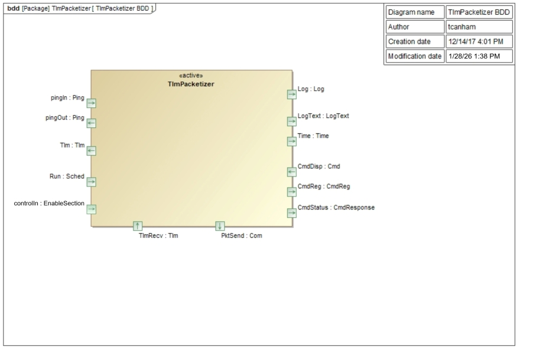
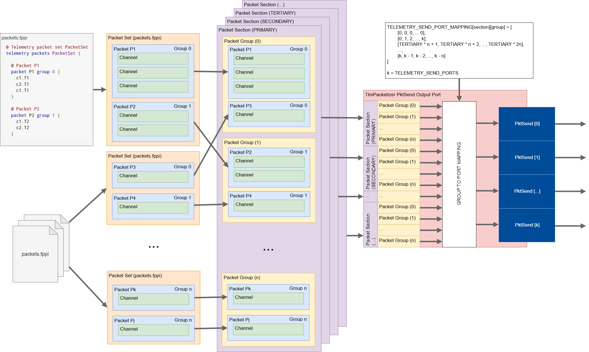

# Svc::TlmPacketizer Component

## 1. Introduction

The `Svc::TlmPacketizer` Component is used to store telemetry values written by other components. The values are stored in serialized form. TlmPacketizer stores telemetry in defined packets, which it sends on invocation of the `run` port. The defined packets are passed in as a table to the `setPacketList()` public method. When telemetry updates are passed to the component, they are placed at the offset in a packet buffer defined by the table. When the `run` port is called, all the defined packets are sent to the output ports with the most recent values. All channels in a packet are pushed together as a packet.

TlmPacketizer has a configurable set of sections (e.g. realtime, recorded, etc.). Every packet has a numerical group (aka level). Every section controls the output of packets based on their group.

Users can change the individual rates at which telemetry groups are output upon a `run` schedule tick for each section/group assignment. Packets can be sent on change with a rate limiting enforced minimum number of ticks between updates. Alternatively, packets can be sent with at a guaranteed rate of a maximum number of ticks between updates. Packets are evaluated individually and have a counter since last invocation. The minimum (MIN) and maximum (MAX) schedule ticks between sent telemetry of the same group is configurable, and users can configure groups within each section to apply logic using MIN, MAX, or both; a group or packet is silenced through its send state (`TlmSendState.SEND_NEVER`) rather than a rate mode. Individual packets may override their group's send state and/or rates per section (see Section 3.3.4).

Packets are output on different ports based on a configurable mapping of section and group to the output port.

## 2. Requirements

The requirements for `Svc::TlmPacketizer` are as follows:

| Requirement | Description | Verification Method |
|---|---|---|
| TPK-001 | The `Svc::TlmPacketizer` component shall provide an interface to submit telemetry | Unit Test |
| TPK-002 | The `Svc::TlmPacketizer` component shall time tag each packet | Unit Test |
| TPK-003 | The `Svc::TlmPacketizer` component shall keep the latest value of each channel | Unit Test |
| TPK-004 | The `Svc::TlmPacketizer` component shall uniquely identify each packet | Unit Test |
| TPK-005 | The `Svc::TlmPacketizer` component shall write packets upon fulfilling the rate send configurations for its group | Unit Test |
| TPK-006 | The `Svc::TlmPacketizer` component shall determine output port index based on section and group | Unit Test |
| TPK-007 | The `Svc::TlmPacketizer` component shall accept a packet specification containing no channels | Unit Test |
| TPK-008 | The `Svc::TlmPacketizer` component shall provide per-packet send-state and rate overrides; a packet's effective configuration shall be its group's configuration with only the overridden fields replaced | Unit Test |
| TPK-009 | The `Svc::TlmPacketizer` component shall provide a command to clear a per-packet override, reverting the packet to its group-derived configuration | Unit Test |
| TPK-010 | The `Svc::TlmPacketizer` component shall mirror per-packet override changes out `packetOverrideOut` and accept a reload of overrides on `packetOverrideIn` for persistence across reboot | Unit Test |
| TPK-011 | The `Svc::TlmPacketizer` component shall event on a configuration referencing an unknown packet id, on a `packetOverrideIn` record carrying a section out of range, and on a `packetOverrideIn` buffer that could not be fully applied | Unit Test |
| TPK-012 | The `Svc::TlmPacketizer` component shall event each per-packet override applied or cleared by command, and shall reject the command when the override could not be mirrored out `packetOverrideOut` | Unit Test |


## 3. Design

### 3.1 Context

#### 3.1.1 Component Diagram

The `Svc::TlmPacketizer` component has the following component diagram:



#### 3.1.2 Ports

The `Svc::TlmPacketizer` component uses the following port types:

Port Data Type | Name | Direction | Kind | Usage
-------------- | ---- | --------- | ---- | -----
[`Svc::Sched`](../../Sched/docs/sdd.md) | Run | Input | Asynchronous | Execute a cycle to write changed telemetry channels
[`Fw::Tlm`](../../../Fw/Tlm/docs/sdd.md) | TlmRecv | Input | Synchronous Input | Update a telemetry channel
[`Fw::TlmGet`](../../../Fw/Tlm/docs/sdd.md) | TlmGet | Input | Synchronous | Read back the latest stored value of a channel
[`Fw::Com`](../../../Fw/Com/docs/sdd.md) | PktSend | Output | n/a | Array of ports used to write packets with updated telemetry
[`Svc::EnableSection`](../../Ports/TlmPacketizerPorts/sdd.md) | controlIn | Input | Asynchronous | Enable / Disable sections of telemetry groups
[`Svc::ConfigureGroupRate`](../../Ports/TlmPacketizerPorts/sdd.md) | configureSectionGroupRate | Input | Asynchronous | Configure a section/group rate logic and thresholds
[`Fw::BufferSend`](../../../Fw/Buffer/docs/sdd.md) | packetOverrideOut | Output | n/a | Mirror a per-packet override change to an external persistence component
[`Fw::BufferSend`](../../../Fw/Buffer/docs/sdd.md) | packetOverrideIn | Input | Asynchronous | Reload per-packet overrides from the persistence component (e.g. at boot)
[`Fw::BufferSend`](../../../Fw/Buffer/docs/sdd.md) | packetOverrideReturnOut | Output | n/a | Return a packetOverrideIn reload buffer to the persistence component after it is applied
[`Fw::BufferGet`](../../../Fw/Buffer/docs/sdd.md) | allocate | Output | n/a | Allocate a buffer for a packetOverrideOut mirror (`Svc.BufferAllocation` interface)
[`Fw::BufferSend`](../../../Fw/Buffer/docs/sdd.md) | packetOverrideReturnIn | Input | Synchronous | Return a packetOverrideOut mirror buffer from the persistence component once it has been consumed
[`Fw::BufferSend`](../../../Fw/Buffer/docs/sdd.md) | deallocate | Output | n/a | Free a returned packetOverrideOut mirror buffer (`Svc.BufferAllocation` interface)
[`Svc::Ping`](../../Ping/docs/sdd.md) | pingIn / pingOut | Input / Output | Asynchronous / n/a | Health ping request and response

#### 3.1.3 Terminology

This SDD and component use the following terminology:

1. Telemetry Point: An emitted telemetry value.
2. Telemetry Channel: A tagged type, identifier, and timestamp for emitting telemetry points.
3. Telemetry Packets: A set of telemetry channels send together.
4. Telemetry Group / Level: An identifier specifying a set of packets that share output configuration.
5. Telemetry Section: A resampling of telemetry groups. Each Section typically is destined for a different destination (e.g. realtime downlink vs store & forward)
6. Output Port: The port used to write telemetry packets. The output port index is determined by the section and group of the packet.

The following example demonstrates the structure composition of packet set specifications and packet sections used in `Svc::TlmPacketizer`. While multiple packet sets can have packets with different group identifiers, a section contains all packets partitioned based on group identifier.



#### 3.2 Functional Description

The `Svc::TlmPacketizer` component has an input port `TlmRecv` that receives channel updates from other components in the system. These calls from the other components are made by the component implementation classes, but the generated code in the base classes takes the type specific channel value and serializes it, then makes the call to the output port. The `Svc::TlmPacketizer` component can then store the channel value as generic data. The channel ID is used to look up offsets for the channel in each of the defined packets. A channel can be defined in more than one packet. The time tag is stripped from the incoming telemetry value. The time tag of the channel will become the time tag of the entire frame when it is sent.

A packet may be specified with no channels (FPP autocodes such a packet with an empty channel list). It is accepted by `setPacketList`, is never marked updated by channel traffic, and is emitted as a header-only packet (descriptor, packet ID, time tag) when explicitly requested with `SEND_PKT`.

When a call to the `Run()` interface is called, each packet is evaluated for output, one at a time. The packet is locked, determined to contain update data, and then unlocked. For each section the packet's effective configuration is assembled from its group's configuration with only the fields selected by its per-packet override copied in, and its send state is resolved packet → group → section enable (`SEND_ALWAYS` ignores the section enable, `SEND_NEVER` silences, `INHERIT_FROM_PARENT` follows the section; see Section 3.3.4). If a packet meets the criteria for output in any section/group, the packet is locked again, copied, unlocked, and then sent on each section requiring output. The actual output port is determined by a configurable map of section/group to output port index.

Each telemetry group, depending on section and group configurations, are sent out on the `pktSend` port array. Since each group is evaluated for each section, a packet with group 1 (and a configuration of 3 sections), will be sent up to 3 times based on the section/group configuration. Each of these sends (section/group) will run through a configurable map to determine which output port to use. Should the output port index be repeated for different section/group pairs, the packet will be sent to that port multiple times.

Port invocations to `controlIn` or the command, `ENABLE_SECTION` are used to enable / disable each section, supporting downstream components that rely on different samplings of groups of telemetry. Each group instance is separately sampled from each other, allowing for individual rates per section and group.

### 3.3 Scenarios

#### 3.3.1 Configuring Telemetry Group Rates Per Port at Runtime

The `Svc::TlmPacketizer` is configurable to have multiple `PktSend` group outputs using the fpp constant, `MAX_CONFIGURABLE_TLMPACKETIZER_GROUP`. Doing so allows each packet group have different configurations for each `PktSend` output section.

Each group within each section are separately sampled, and have their own configuration rates and logic independent from each other. These section/group pairs have their own mapping to output port in the output port map.

Each group is configured with min/max delta parameters, as well as a logic gate determining its output rate behavior. Deltas are counters of schedule ticks invoked through the `run()` port. Min Delta is the least number of `Run()` invocations between successive packets before a packet with an updated channel is allowed to be sent. Updated packets will not be sent until their counter reaches Min Delta. This mitigates against telemetry spam while allowing users to benefit from asynchronously updating channels (e.g. those that don't occupy a set schedule). Max Delta is the maximum number of `Run()` invocations between successive packets. Upon reaching this counter, the packet would be sent, regardless of change.

Each telemetry group per section is configured with a `RateLogic` parameter (to silence a group, set its send state to `SEND_NEVER`, see Section 3.3.3):
* `EVERY_MAX`: Packet will be sent every Max Delta intervals
* `ON_CHANGE_MIN`: Packet will only be sent on updates at at least Min Delta intervals.
* `ON_CHANGE_MIN_OR_EVERY_MAX`: Packet will be sent on updates at at least Min Delta intervals, or at most Max Delta intervals.

Note: `MAX` will take priority over `MIN` if less than `MIN` and the telemetry group is set to `ON_CHANGE_MIN_OR_EVERY_MAX`. 

Groups are configured using the `CONFIGURE_GROUP_RATES` command.

#### 3.3.3 Switching Telemetry Sections
`Svc::TlmPacketizer` also has a configurable constant `TelemetrySection::NUM_SECTIONS` that allows separately streamed outputs of packets of the same group. This is useful for downstream components that would handle different telemetry groups at different rates. Examples of this configuration includes live telemetry throughput, detailed sim reconstruction, or critical data operations.

Telemetry sections are enabled and disabled upon spacecraft state transitions through `controlIn()` port invocations or via operator commands. Every group (and every packet override, Section 3.3.4) carries a `TlmSendState`, which is resolved packet -> group -> section:

* `INHERIT_FROM_PARENT`: use the state of the level above. For a group the parent is the section enable: the group sends while its section is enabled. This is the default.
* `SEND_WHEN_SECTION_ENABLED`: send while the section is enabled (at group level this behaves like `INHERIT_FROM_PARENT`).
* `SEND_ALWAYS`: send regardless of the section enable.
* `SEND_NEVER`: never send.

* `ENABLE_SECTION` / `controlIn()`: Enable / Disable telemetry sections.
* `CONFIGURE_GROUP_SEND`: Set the send state of a group within a section; the new state is reported with the `GroupSendStateSet` event and the `GroupConfigs` channel.
* `SET_LEVEL`: Groups at or below the level are set to `INHERIT_FROM_PARENT`, groups above it to `SEND_NEVER`; any `SEND_ALWAYS` / `SEND_NEVER` previously set with `CONFIGURE_GROUP_SEND` is replaced (packet overrides are not touched).

Disabling groups / sections will freeze the group's counter between sent output.
Updated groups using `ON_CHANGE_MIN` or `ON_CHANGE_MIN_OR_EVERY_MAX` while group disabled / section disabled will be marked "NEW" but not sent. The group counter resumes once the group / section is re-enabled and will be sent upon reaching their MIN counter.

#### 3.3.4 Per-Packet Configuration Overrides

Beyond the section/group controls above, `Svc::TlmPacketizer` supports fine-grained *per-packet* overrides. An override targets a single (packet id, section) pair and is a `PacketOverrideConfig`: a `PacketOverrideType` saying which fields override the group (`GROUP_DEFAULT`, `OVERRIDE_SEND`, `OVERRIDE_RATES`, `OVERRIDE_SEND_AND_RATES`) plus a `TlmSendConfig` holding the override values. The following commands manage overrides:

* `OVERRIDE_PACKET_SEND`: Override the send state of a single packet in a section (`INHERIT_FROM_PARENT` at packet level means "use the group's state").
* `OVERRIDE_PACKET_RATES`: Override the rate logic and MIN/MAX thresholds of a single packet.
* `GET_PACKET_CONFIG`: Query a packet; the stored override and the resulting effective configuration are emitted as the `PacketConfigReport` event.
* `CLEAR_PACKET_OVERRIDE`: Remove a packet's override (`GROUP_DEFAULT`), reverting it to its group.

Each successful `OVERRIDE_PACKET_SEND` or `OVERRIDE_PACKET_RATES` emits `PacketOverrideSet` carrying the stored override; a successful `CLEAR_PACKET_OVERRIDE` emits `PacketOverrideCleared`. An out-of-range section answers `VALIDATION_ERROR` with `InvalidPacketConfig`, an unknown packet id with `PacketNotFound`; invalid enumerated arguments are rejected by command deserialization with `FORMAT_ERROR`.

**Effective configuration.** On every `Run` cycle a packet's effective `TlmSendConfig` is assembled by reading its group's configuration and copying in only the fields selected by its `PacketOverrideType`. Fields that are not overridden keep following the group, so a packet whose send state is overridden still picks up later `CONFIGURE_GROUP_RATES` changes. The send command on a packet that already overrides its rates (or vice versa) yields `OVERRIDE_SEND_AND_RATES`; repeating a command replaces that field's value. The effective send state is then resolved against the section enable as described in Section 3.3.3: a packet `SEND_ALWAYS` emits even in a disabled section, `SEND_WHEN_SECTION_ENABLED` still honours the section, `SEND_NEVER` is silent even in a `SEND_ALWAYS` group.

**Persistence (`packetOverrideOut` / `packetOverrideIn`).** Whenever a command changes or clears an override, the packetizer allocates a buffer, serializes the resulting `PacketConfigEntry` (packet id, section, `PacketOverrideConfig`), and mirrors it out the `packetOverrideOut` port to an external persistence component. The persistence component pushes stored overrides back in on the `packetOverrideIn` port as a buffer holding one or more serialized `PacketConfigEntry` records. The packetizer applies each whole record in turn (a `GROUP_DEFAULT` record clears the slot) with a bounded loop over `size / PacketConfigEntry::SERIALIZED_SIZE` records: a record for an unknown packet id raises `ReloadRecordUnknownPacket` and a record whose section is out of range raises `ReloadRecordInvalid`; both are skipped. Enumerated values are validated by deserialization, so a record carrying an invalid enum value ends the reload: `ConfigReloadFailed` is emitted with the deserialization status, as it is when trailing bytes do not form a whole record, so a truncated or corrupted store is never silently partially applied. The reload buffer is always handed back on `packetOverrideReturnOut`, even when it is invalid or malformed. The reload path never echoes back out `packetOverrideOut`.

**Buffer ownership.** `packetOverrideOut` mirror buffers are allocated through the `Svc.BufferAllocation` interface (`allocate`) and lent to the receiver, which hands each one back on `packetOverrideReturnIn` once it has consumed the record; the packetizer then frees it through `deallocate`, so the mirror pool is owned end to end by the component that drew from it. `packetOverrideIn` reload buffers are owned by their sender and are handed back on `packetOverrideReturnOut` after they are applied (valid or not), so the persistence component may draw them from any pool. The mirror path is wired as a whole or not at all: `packetOverrideOut`, `allocate`, `deallocate` and `packetOverrideReturnIn` go together — when `packetOverrideOut` is connected the component asserts that `allocate` and `deallocate` are too, so a half-wired mirror path fails at the first override command rather than silently not persisting or leaking. A topology that wires `packetOverrideIn` must also wire `packetOverrideReturnOut` (the handler asserts it is connected), otherwise every reload buffer would leak from the sender's pool. Size the mirror pool for at least one `PacketConfigEntry::SERIALIZED_SIZE`-byte buffer per override command that can be in flight before the receiver frees it; when the pool is dry a command answers `EXECUTION_ERROR` after rolling back, so the volatile and persisted copies never diverge (see Section 4.6).

**Persistence mechanism rationale.** Overrides are mirrored as serialized records over a buffer port pair rather than stored as an `Fw::Prm` external parameter because the dense override table (`TelemetrySection::NUM_SECTIONS × MAX_PACKETIZER_PACKETS` records) can exceed the default `FW_PARAM_BUFFER_MAX_SIZE`, and the buffer path lets the integrator choose a persistence component sized to the deployment.

**Query result.** The `GET_PACKET_CONFIG` result is emitted asynchronously as the `PacketConfigReport` event carrying the section, packet id, stored `PacketOverrideConfig`, and effective `TlmSendConfig`.

### 3.4 State

`Svc::TlmPacketizer` has no state machines.

### 3.5 Algorithms

In order to speed up lookups for storing and reading telemetry channels, a simple hash function is used to select a location in an array of hash table slots.
A configuration value in `TlmPacketizerImplCfg.h` defines a set of hash buckets to store the telemetry values. The number of buckets has to be at least as large as the number of telemetry channels defined in the system. The number of channels in the system can be determined by invoking `make comp_report_gen` from the deployment directory. The number of has table slots `TLMPACKETIZER_NUM_TLM_HASH_SLOTS` and the hash value `TLMPACKETIZER_HASH_MOD_VALUE` in the configuration file can be varied to balance the amount of memory for slots versus the distribution of buckets to slots. See `TlmPacketizerImplCfg.h` for a procedure on how to tune the algorithm.

## 4. Configuration

The `Svc::TlmPacketizer` component has the following configuration parameters:

- `MAX_PACKETIZER_PACKETS` (TlmPacketizerCfg.fpp): Maximum allowed packets
- `MAX_PACKETIZER_CHANNELS` (TlmPacketizerCfg.hpp): Maximum allowed telemetry channels
- `TLMPACKETIZER_MAX_MISSING_TLM_CHECK` (TlmPacketizerCfg.hpp): Maximum reported missing telemetry channels
- `TelemetrySection` (TlmPacketizerCfg.fpp): An enumeration of the telemetry sections used by the project. Must end with `NUM_SECTIONS` to specify the number of sections.
- `MAX_CONFIGURABLE_TLMPACKETIZER_GROUP` (TlmPacketizerCfg.fpp): Maximum value allowed for a packet's group/level identifier
- `TELEMETRY_SEND_PORTS` (TlmPacketizerCfg.fpp): Number of output ports for telemetry packets
- `TELEMETRY_SEND_PORT_MAPPING` (TlmPacketizerCfg.fpp): A mapping of each section/group pair to the output port index used.
- `TELEMETRY_SECTION_DEFAULTS` (TlmPacketizerCfg.fpp): A mapping of each section/group pair to the default rate logic and parameters for that section/group pair.
- `FwTlmPacketizeOffsetType` (TlmPacketizerCfg.fpp): Integer type used to store a channel's byte offset within a packet buffer (default `U16`). It must be able to represent `FW_COM_BUFFER_MAX_SIZE` (enforced by a `static_assert` in `TlmPacketizer.cpp`); a project with a larger com buffer widens it here. The channel table holds `MAX_PACKETIZER_CHANNELS × MAX_PACKETIZER_PACKETS` offsets of this type, so widening it from `U16` to `U32` doubles that table (20 kB to 40 kB at default sizes).

### 4.1 Sizing

Overall memory usage of the `Svc::TlmPacketizer` is determined by the following configuration parameters: `MAX_PACKETIZER_PACKETS`, `MAX_PACKETIZER_CHANNELS`, `TLMPACKETIZER_MAX_MISSING_TLM_CHECK`, `TelemetrySection::NUM_SECTIONS`, and `FwTlmPacketizeOffsetType` (each channel slot holds `MAX_PACKETIZER_PACKETS` offsets of this type, so the channel table scales as `MAX_PACKETIZER_CHANNELS × MAX_PACKETIZER_PACKETS × sizeof(FwTlmPacketizeOffsetType)`).

The per-packet override table adds a dense static block of `TelemetrySection::NUM_SECTIONS × MAX_PACKETIZER_PACKETS` `PacketOverrideConfig` entries. All enumerations use `U8` storage so a record serializes to a few bytes; in RAM each entry is an FPP struct whose nested serializables each carry a vtable pointer (roughly 44 bytes on a 32-bit target, 80 bytes on a 64-bit target). At the sample defaults (2 sections × 50 packets) this is about 4.4 kB (8 kB on 64-bit); a project with many sections and packets should budget for it, since the table scales with the configured maximum packet count, not with the number of overrides in use.

`MAX_PACKETIZER_PACKETS` determines the size of storage for the telemetry packets registered by components. It should be set to at least the number of packets defined in the system, but may be larger to allow for a project's packet growth over time without incurring additional memory usage.

`MAX_PACKETIZER_CHANNELS` determines the size of storage for the telemetry channels registered by components. It should be set to at least the number of non-omitted channels defined in the system, but may be larger to allow for a project's channel growth over time without incurring additional memory usage.

`TLMPACKETIZER_MAX_MISSING_TLM_CHECK` determines the size of the data structure used to track and event on missing telemetry channels. Most projects should set this to a low number since missing channels are a rarity with FPP defined telemetry channels.

`MAX_PACKETIZER_PACKETS` is set in [`TlmPacketizerCfg.fpp`](http://github.com/nasa/fprime/blob/devel/Svc/TlmPacketizer/config/TlmPacketizerConfig/TlmPacketizerCfg.fpp) (it sizes FPP array types); the other two are set in [`TlmPacketizerCfg.hpp`](http://github.com/nasa/fprime/blob/devel/Svc/TlmPacketizer/config/TlmPacketizerConfig/TlmPacketizerCfg.hpp).

The number of sections is determined by the `TelemetrySection` enum. A project may enumerate any number of sections and must end the enum with `NUM_SECTIONS`.

The number of groups is determined by the `NUM_CONFIGURABLE_TLMPACKETIZER_GROUPS` parameter. This should be set to at least the maximum group identifier used in the system + 1, but may be larger to allow for growth over time.

Sizes of maps and output configuration is then determined by (`NUM_CONFIGURABLE_TLMPACKETIZER_GROUPS`) * `TelemetrySection::NUM_SECTIONS`.

The number of output ports for telemetry is set by: `TELEMETRY_SEND_PORTS`. This may be set to any positive number of ports. Setting this to more than number of sections * number of groups will result in unused ports.

### 4.2 Output Port Mapping

The value of `TELEMETRY_SEND_PORT_MAPPING` maps each section/group pair to an output port index. It must be a constant array of type `FwIndexType[NUM_SECTIONS][MAX_CONFIGURABLE_TLMPACKETIZER_GROUPS]`.  A field at `TELEMETRY_SEND_PORT_MAPPING[section][group]` is set to the output index to used. Each field must be < `TELEMETRY_SEND_PORTS`. Multiple section/group pairs may map to the same output port index, but each field must be a valid port index.

Here is an example with 2 sections and 4 groups (max group identifier of 3). In this example, a section uses the same output port across all groups.

```py
    constant TELEMETRY_SEND_PORT_MAPPING = [
        [0, 0, 0, 0], # All groups in section 0 use port 0
        [1, 1, 1, 1], # All groups in section 1 use port 1
    ]
```

### 4.3 Default Output Rate Limits 

Default rate limits for each section/group pair is set by the `TELEMETRY_SECTION_DEFAULTS` constant. It must be a constant of the `SectionConfigs` array type. Each field at `TELEMETRY_SECTION_DEFAULTS[section][group]` is a `Svc::TlmSendConfig` carrying the default `sendState` and `rates` (`rateLogic`, `min`, `max`) for that section/group pair. These defaults are used to initialize the section/group pair's configuration upon component initialization, but can be changed at runtime using the `CONFIGURE_GROUP_SEND` and `CONFIGURE_GROUP_RATES` commands.

Here is an example with 2 sections and 4 groups that sets all section/group pairs to update-on-change with no min nor max.

```py
    constant TELEMETRY_SECTION_DEFAULTS = [
        # REALTIME section
        [
            # Group 0
            { sendState = TlmSendState.INHERIT_FROM_PARENT, rates = { rateLogic = RateLogic.ON_CHANGE_MIN, min = 0, max = 0 } },
            # Group 1
            { sendState = TlmSendState.INHERIT_FROM_PARENT, rates = { rateLogic = RateLogic.ON_CHANGE_MIN, min = 0, max = 0 } },
            # Group 2
            { sendState = TlmSendState.INHERIT_FROM_PARENT, rates = { rateLogic = RateLogic.ON_CHANGE_MIN, min = 0, max = 0 } },
            # Group 3
            { sendState = TlmSendState.INHERIT_FROM_PARENT, rates = { rateLogic = RateLogic.ON_CHANGE_MIN, min = 0, max = 0 } },
        ],
        # RECORDED section
        [
            # Group 0
            { sendState = TlmSendState.INHERIT_FROM_PARENT, rates = { rateLogic = RateLogic.ON_CHANGE_MIN, min = 0, max = 0 } },
            # Group 1
            { sendState = TlmSendState.INHERIT_FROM_PARENT, rates = { rateLogic = RateLogic.ON_CHANGE_MIN, min = 0, max = 0 } },
            # Group 2
            { sendState = TlmSendState.INHERIT_FROM_PARENT, rates = { rateLogic = RateLogic.ON_CHANGE_MIN, min = 0, max = 0 } },
            # Group 3
            { sendState = TlmSendState.INHERIT_FROM_PARENT, rates = { rateLogic = RateLogic.ON_CHANGE_MIN, min = 0, max = 0 } },
        ]
    ]
```

### 4.4 Sample Configuration: Realtime and Recorded Sections with a Single Output Port for Each

This section will show configuration for 2 sections (LIVE, RECORDED) each outputting all groups to a dedicated output port. Four groups are allowed (0, 1, 2, 3).

```py
enum TelemetrySection {
    @ First section, LIVE 
    LIVE,
    @ Second section, RECORDED
    RECORDED,
    NUM_SECTIONS,     @< REQUIRED: Counter, leave as last element.
}
@ Allows groups 0, 1, 2, and 3
NUM_CONFIGURABLE_TLMPACKETIZER_GROUPS = 4

@ Allows output ports 0, and 1
TELEMETRY_SEND_PORTS = 2

@ Each section uses a single output port for all groups 0-3
constant TELEMETRY_SEND_PORT_MAPPING = [
    [0, 0, 0, 0], # All groups in section 0 use port 0
    [1, 1, 1, 1], # All groups in section 1 use port 1
]
@ Set the default rate logic for all section/group pairs to update-on-change with no min nor max.
constant TELEMETRY_SECTION_DEFAULTS = [
    # LIVE section
    [
        # Group 0
        { sendState = TlmSendState.INHERIT_FROM_PARENT, rates = { rateLogic = RateLogic.ON_CHANGE_MIN, min = 0, max = 0 } },
        # Group 1
        { sendState = TlmSendState.INHERIT_FROM_PARENT, rates = { rateLogic = RateLogic.ON_CHANGE_MIN, min = 0, max = 0 } },
        # Group 2
        { sendState = TlmSendState.INHERIT_FROM_PARENT, rates = { rateLogic = RateLogic.ON_CHANGE_MIN, min = 0, max = 0 } },
        # Group 3
        { sendState = TlmSendState.INHERIT_FROM_PARENT, rates = { rateLogic = RateLogic.ON_CHANGE_MIN, min = 0, max = 0 } },
    ],
    # RECORDED section
    [
        # Group 0
        { sendState = TlmSendState.INHERIT_FROM_PARENT, rates = { rateLogic = RateLogic.ON_CHANGE_MIN, min = 0, max = 0 } },
        # Group 1
        { sendState = TlmSendState.INHERIT_FROM_PARENT, rates = { rateLogic = RateLogic.ON_CHANGE_MIN, min = 0, max = 0 } },
        # Group 2
        { sendState = TlmSendState.INHERIT_FROM_PARENT, rates = { rateLogic = RateLogic.ON_CHANGE_MIN, min = 0, max = 0 } },
        # Group 3
        { sendState = TlmSendState.INHERIT_FROM_PARENT, rates = { rateLogic = RateLogic.ON_CHANGE_MIN, min = 0, max = 0 } },
    ]
]
```

### 4.5 Sample Configuration: Dedicated Output Port for Each Group in Each Section

This section will show configuration for 3 sections (LIVE, RECORDED, EXTRA) each outputting 2 groups (0, 1) to a dedicated output port. This results in 6 total output ports. This one will require that LIVE telemetry is sent no more often that every 3 ticks, and no less often than every 10 ticks.

```py
enum TelemetrySection {
    @ First section, LIVE 
    LIVE,
    @ Second section, RECORDED
    RECORDED,
    @ Third section, EXTRA
    EXTRA,
    NUM_SECTIONS,     @< REQUIRED: Counter, leave as last element.
}
@ Allows groups 0, 1
NUM_CONFIGURABLE_TLMPACKETIZER_GROUPS = 2

@ Allows output ports 0, 1, 2, 3, 4, 5
TELEMETRY_SEND_PORTS = 6

@ Each section/group uses a unique output port
constant TELEMETRY_SEND_PORT_MAPPING = [
    [0, 1],
    [2, 3],
    [4, 5],
]
@ Set the default rate logic for all section/group pairs to update-on-change with no min nor max.
constant TELEMETRY_SECTION_DEFAULTS = [
    # LIVE section
    [
        # Group 0
        { sendState = TlmSendState.INHERIT_FROM_PARENT, rates = { rateLogic = RateLogic.ON_CHANGE_MIN_OR_EVERY_MAX, min = 3, max = 10 } },
        # Group 1
        { sendState = TlmSendState.INHERIT_FROM_PARENT, rates = { rateLogic = RateLogic.ON_CHANGE_MIN_OR_EVERY_MAX, min = 3, max = 10 } },
    ],
    # RECORDED section
    [
        # Group 0
        { sendState = TlmSendState.INHERIT_FROM_PARENT, rates = { rateLogic = RateLogic.ON_CHANGE_MIN, min = 0, max = 0 } },
        # Group 1
        { sendState = TlmSendState.INHERIT_FROM_PARENT, rates = { rateLogic = RateLogic.ON_CHANGE_MIN, min = 0, max = 0 } },
    ],
    # EXTRA section
    [
        # Group 0
        { sendState = TlmSendState.INHERIT_FROM_PARENT, rates = { rateLogic = RateLogic.ON_CHANGE_MIN, min = 0, max = 0 } },
        # Group 1
        { sendState = TlmSendState.INHERIT_FROM_PARENT, rates = { rateLogic = RateLogic.ON_CHANGE_MIN, min = 0, max = 0 } },
    ]
]
```

### 4.6 Per-Packet Configuration Buffers

Per-packet override mirror (`packetOverrideOut`) and reload (`packetOverrideIn`) exchange serialized `PacketConfigEntry` records inside an `Fw.Buffer`, rather than a fixed-size array. A `packetOverrideOut` mirror carries a single record sized to `PacketConfigEntry::SERIALIZED_SIZE`, drawn through the `allocate` port; a `packetOverrideIn` reload may carry many records packed back-to-back, and the packetizer applies each whole record before returning the buffer on `packetOverrideReturnOut`. A deployment that persists overrides wires `allocate` and `deallocate` to a BufferManager whose pool is sized for these records, `packetOverrideOut` to the persistence component, and the persistence component's buffer-return output back to `packetOverrideReturnIn` so each mirror buffer is freed to that pool (see "Buffer ownership" in Section 3.3.4), and sizes the component's message queue to absorb reload traffic alongside its other async ports (`Run`, `controlIn`, `configureSectionGroupRate`, commands). If a mirror buffer cannot be allocated, `ConfigMirrorAllocFailed` is emitted, the override (or clear) is rolled back so the volatile table never diverges from the persisted copy, and the command answers `EXECUTION_ERROR`; the operator may retry once the pool has free buffers. When `packetOverrideOut` is not connected there is no persisted copy to keep in step and commands apply locally without a mirror.

`packetOverrideIn` is an asynchronous port, so each reload buffer becomes one message on the component's queue, and the queue asserts when full. A persistence component that replays stored overrides at boot must therefore batch them into no more buffers than the component's configured queue depth — ideally a single buffer holding all records, since one buffer may carry many records back-to-back. Dropping a reload buffer is not an option (a dropped buffer is never returned to the pool), so sizing the reload into the queue is the integrator's responsibility. See the "Buffer ownership" note in Section 3.3.4 for the pool and ownership contract.
## 5. Unit Testing

To see unit test coverage run fprime-util check --coverage

## 7. Change Log

Date | Description
---- | -----------
12/14/2017 | Initial version
01/23/2026 | Added group level rate logic
02/23/2026 | Added section/group mapping logic
03/30/2026 | Added configuration section
09/30/2026 | Added per-packet configuration
10/23/2026 | Review follow-ups: override/clear/reload events, reload validation, mirror-failure rollback
10/26/2026 | `TlmSendState` replaces enabled/force/SILENCED; per-field packet overrides (`PacketOverrideType`); `CONFIGURE_*_SEND` commands; reload buffers returned on `packetOverrideReturnOut`. **Migration:** the serialized shape of `SECTION_CONFIGS` changed (`GroupConfig` → `TlmSendConfig`); a saved value of the old shape is rejected at load (`FW_DESERIALIZE_SIZE_MISMATCH`) and the defaults apply, so regenerate or re-save the parameter database
10/26/2026 | Renamed CONFIGURE_PACKET_SEND/RATES to OVERRIDE_PACKET_SEND/RATES; added packetOverrideReturnIn for mirror buffers
10/27/2026 | Buffer lock taken with `Os::ScopeLock`; `Run` snapshots only the packet buffer and time tag under the lock; new configuration type `FwTlmPacketizeOffsetType` (default `U16`) types the per-channel packet offsets. **Migration:** a project that overrides `TlmPacketizerCfg.fpp` must add `type FwTlmPacketizeOffsetType = U16` to its copy (the generated `FwTlmPacketizeOffsetTypeAliasAc.h` is included by `TlmPacketizer.hpp`)
